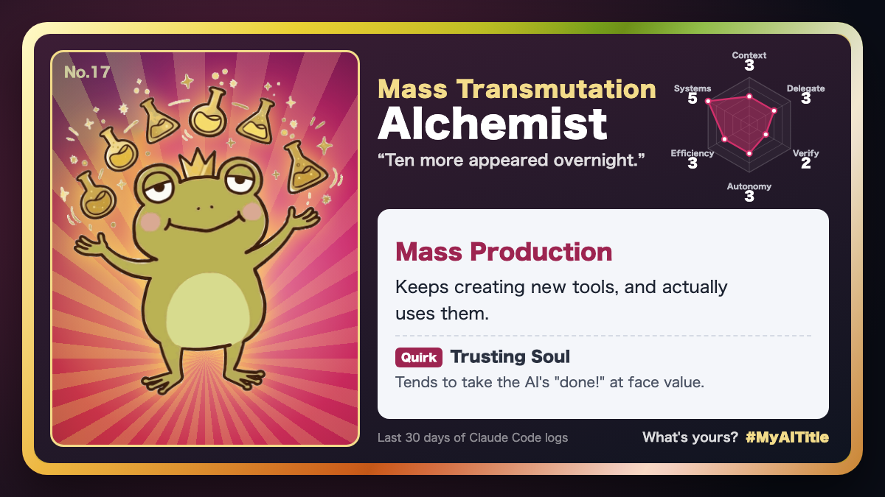

# My AI Title (AI肩書き診断)

[日本語](README.md)

A plugin that reads your Claude Code session logs, scores how you work with AI on six axes, and makes one trading-card style image you can post straight to X or anywhere else.



> Unofficial tool. Not affiliated with Anthropic.

## What it does

- Scores six axes from 1 to 5 using the last 30 days of logs (configurable): Context Design, Delegation, Verification, Autonomy Design, Intervention Efficiency, Systematization
- Picks your "AI title" from 8 types and 32 abilities (e.g. Silent Sniper). With the right record, you get a rare card
- Picks one "quirk" from the axis with the most room to grow
- Outputs a 1200×675 PNG in Japanese or English

## Requirements

- Claude Code
- Python 3.8 or later (no extra packages)
- For drawing the card, one of:
  - Chrome, Edge, Brave or Chromium (recommended)
  - Otherwise Pillow (`python3 -m pip install Pillow`), which draws a simpler card

## Install

Inside Claude Code:

```
/plugin marketplace add KazumiHARADA/my-ai-title
/plugin install my-ai-title@kharada
```

From a terminal:

```
claude plugin marketplace add KazumiHARADA/my-ai-title
claude plugin install my-ai-title@kharada
```

## Usage

Open Claude Code in the project you want to diagnose and ask. Only **that project's sessions** are used (the git root and below, worktrees included).

```
Make my AI title card in English
```

- Another period: "Make my AI title card from the last 60 days"
- Every project: "Make my AI title card from all my projects"
- Another project: "Make my AI title card for ~/Projects/foo"
- Japanese card too: "Also make the Japanese card"

Without a language, the card uses the language that appears most in your logs (Japanese or English; other languages get the English card).

The card is saved on your Desktop with the date in its name, such as `my-ai-title-card-en-2026-11-16.png` (Japanese: `my-ai-title-card-…`), and opened in your image viewer. Running it again on the same day adds `-2`, `-3`, so earlier cards are never overwritten. If the Desktop cannot be written, it goes to `~/.claude/my-ai-title/`, then the current directory. Along with the card, the chat shows the score and evidence for each of the six axes and how to raise the lowest one.

## How your data is handled

- **Local scripts read the logs.** They read the session logs in `~/.claude/projects` and compute counts and ratios on your machine. The scripts never access the network.
- **Excerpts of your logs are sent to Claude (Anthropic's API) for scoring.** A few characteristic sessions are picked, redacted, and read by Claude through the same path as your normal Claude Code session (your instructions and the AI's final reports, for example). Logs, numbers, scores and images are never sent to any other service or to any server of ours.
- **Redaction:** strings that look like API keys, tokens or passwords, e-mail addresses, URLs, file paths, host names, and likely company, person and place names are masked; code blocks and pasted logs are omitted. This is automatic and cannot catch every proper noun (for example place names written only in kanji). By default only the current project's sessions are read, so other projects' content is never sent.
- **Never on the card:** specific numbers (counts, ratios, durations, times of day), anything that reveals working hours or time away, and work details such as code, company, file or project names.
- **What it launches:** to turn the card into an image, it starts an installed Chromium-based browser (Chrome, Edge, Brave and so on) in headless mode with its network features turned off, and screenshots a locally built HTML page. Without a browser it draws the card with Pillow. The finished card is opened in your system's image viewer.
- **What stays on your machine:** the card image, and your previous six scores for growth detection (`~/.claude/my-ai-title/history.json`, scores and dates only). Intermediate files go to a temporary directory.

## How it works

| Step | Done by |
|---|---|
| Logs → numeric metrics | Scripts (the same logs always give the same numbers) |
| Scoring the six axes, judging some conditions | Claude, following the [rubric](skills/my-ai-title/references/rubric.md) |
| Type, ability, quirk, rare, and the card wording | Scripts, using only the fixed text in the [type definitions](skills/my-ai-title/references/types.md) |

## License

- Code: [MIT License](LICENSE)
- Character artwork: under a separate license. It may be used only within this plugin (including sharing the cards it generates); redistribution, modification and commercial use are not permitted. See [assets/characters/LICENSE](skills/my-ai-title/assets/characters/LICENSE).

## Development

```
python3 -m unittest discover -s tests
MY_AI_TITLE_SLOW=1 python3 -m unittest discover -s tests   # check every title fits, in a browser (~90 s)
python3 tests/fixtures/make_fixtures.py                   # regenerate the synthetic test logs
```

Tests use synthetic logs only. No real logs are ever committed.
