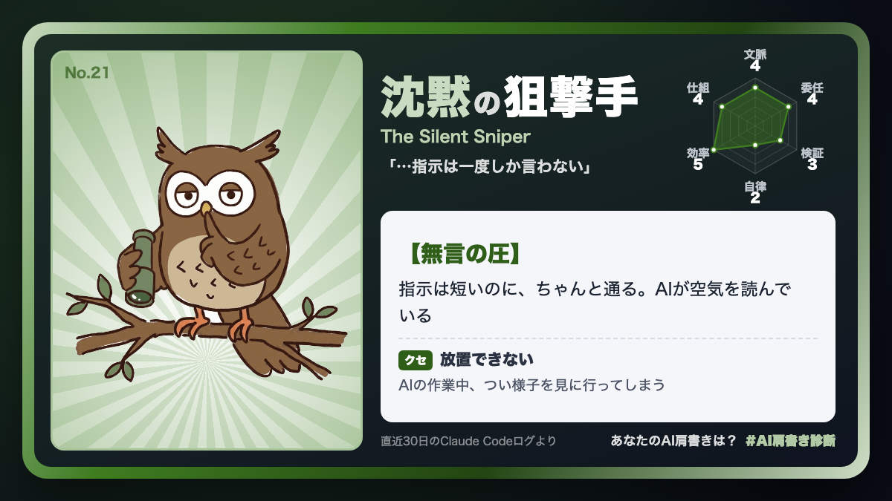

# AI肩書き診断（My AI Title）

[English](README.en.md)

Claude Code のセッションログから、あなたのAIの使い方を6つの軸で診断し、トレーディングカード風の画像を1枚つくるプラグインです。画像はそのまま X などに投稿できます。



> 非公式のツールです。Anthropic とは関係ありません。

## 何ができるか

- 直近30日（変更可）のログから、6つの軸（文脈設計・委任力・検証力・自律化設計・介入効率・仕組み化）を1〜5点で診断します
- 8つのタイプと32の技名から、あなたの「AI肩書き」を決めます（例：沈黙の狙撃手）。条件がそろうとレア版になります
- いちばん伸びしろのある軸から「クセ」を1つ選びます
- 1200×675 の PNG を、日本語版・英語版で出力します

## 必要なもの

- Claude Code
- Python 3.8 以上（追加のパッケージは不要）
- 画像の描画に、次のどちらか
  - Chrome、Edge、Brave、Chromium のいずれか（おすすめ）
  - どれもない場合は Pillow（`python3 -m pip install Pillow`）。簡易版のカードになります

## インストール

Claude Code の中で：

```
/plugin marketplace add KazumiHARADA/my-ai-title
/plugin install my-ai-title@kharada
```

ターミナルから：

```
claude plugin marketplace add KazumiHARADA/my-ai-title
claude plugin install my-ai-title@kharada
```

## 使い方

診断したいプロジェクトのフォルダで Claude Code を開いて、頼むだけです。対象は、**今いるプロジェクトのセッションだけ**です（git リポジトリならそのルート以下。worktree も含む）。

```
AI肩書き診断して
```

- 期間を変える：「直近60日でAI肩書き診断して」
- 全部のプロジェクトで診断する：「全部のプロジェクトでAI肩書き診断して」
- 別のプロジェクトで診断する：「~/Projects/foo でAI肩書き診断して」
- 英語版も作る：「英語版のカードも作って」

言語を指定しなければ、ログでいちばん多く使われている言語でカードを作ります（日本語か英語。それ以外の言語は英語版になります）。

カードはデスクトップに `my-ai-title-card-2026-11-16.png` のような日付つきの名前で保存され（英語版は `my-ai-title-card-en-…`）、画像ビューアで開きます。同じ日に何度か診断すると `-2`、`-3` と番号がつき、前のカードは上書きしません。デスクトップに書き込めないときは `~/.claude/my-ai-title/`、それも無理ならカレントディレクトリに保存します。カードと一緒に、6軸それぞれの点数と根拠、いちばん低い軸の伸ばし方をチャットに表示します。

## データの扱い

- **ログを読むのは手元のスクリプトです。** `~/.claude/projects` のセッションログを読み、回数や割合などの数値を手元で計算します。スクリプトはネットワークにアクセスしません。
- **採点のために、ログの抜粋が Claude（Anthropic の API）に送られます。** 特徴的なセッションを数件選び、秘匿化した抜粋（あなたの指示文と、AIの完了報告など）を、いつもの Claude Code のセッションと同じ経路で Claude が読みます。それ以外の外部サービスや独自のサーバーには、ログ・数値・スコア・画像を一切送りません。
- **秘匿化の内容：** APIキー・トークン・パスワードらしき文字列、メールアドレス、URL、ファイルパス、ホスト名、社名・人名・地名らしき固有名詞を伏せ字にし、コードブロックと貼り付けたログは中身を省略します。機械的な処理なので、漢字だけの地名など、すべての固有名詞を確実に伏せられるわけではありません。既定では今いるプロジェクトのセッションだけを読むので、ほかのプロジェクトの内容は送られません。
- **カードに載せないもの：** 回数・割合・時間・時間帯などの具体的な数字、働く時間帯や離席が読み取れる表現、コード・社名・ファイル名・プロジェクト名などの業務内容。
- **起動するもの：** カードを画像にするため、インストール済みの Chromium 系ブラウザ（Chrome・Edge・Brave など）を、ネットワーク系の機能を切ったヘッドレスモードで起動し、手元で作った HTML を撮影します。ブラウザがなければ Pillow で描きます。描き終わったカードは OS の画像ビューアで開きます。
- **手元に残るもの：** カード画像と、成長の判定のための前回の6軸スコア（`~/.claude/my-ai-title/history.json`、スコアと日付だけ）。途中の作業ファイルは一時フォルダに作られます。

## 診断のしくみ

| 処理 | 担当 |
|---|---|
| ログ → 数値の指標 | スクリプト（同じログからは同じ数値） |
| 6軸の採点と、一部の条件の判定 | Claude（[採点基準](skills/my-ai-title/references/rubric.md)に従う） |
| タイプ・技名・クセ・レアの決定と、カードの文言 | スクリプト（[タイプ定義](skills/my-ai-title/references/types.md)の固定文だけを使う） |

## ライセンス

- コード：[MIT License](LICENSE)
- キャラクター画像：コードとは別のライセンスです。このプラグインでの利用（生成したカードのシェアを含む）に限り、再配布・改変・商用利用はできません。詳しくは [assets/characters/LICENSE](skills/my-ai-title/assets/characters/LICENSE) を見てください。

## 開発

```
python3 -m unittest discover -s tests
MY_AI_TITLE_SLOW=1 python3 -m unittest discover -s tests   # 全称号のはみ出しをブラウザで確認（約1分半）
python3 tests/fixtures/make_fixtures.py                   # テスト用の合成ログを作り直す
```

テストは合成したダミーのログだけを使います。実際のログはリポジトリに含めません。
